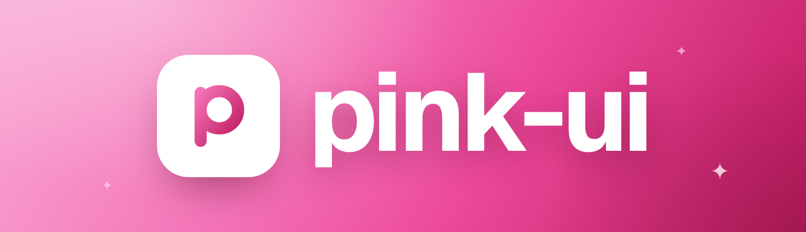
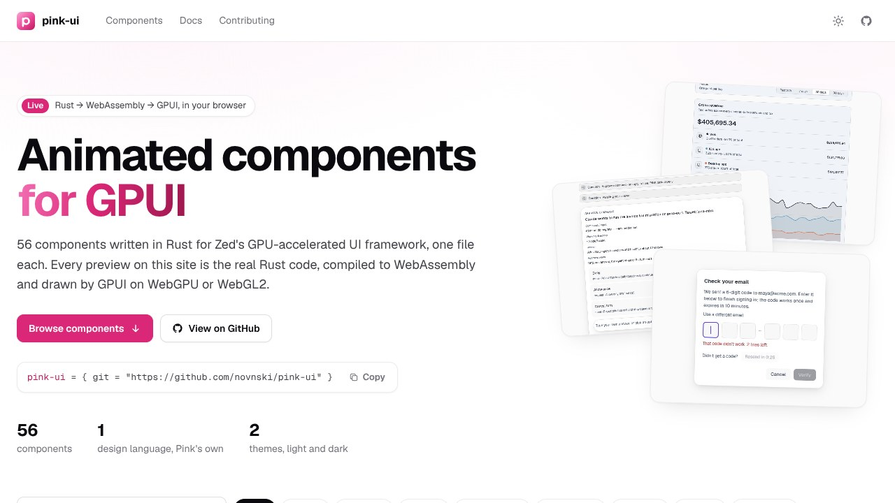
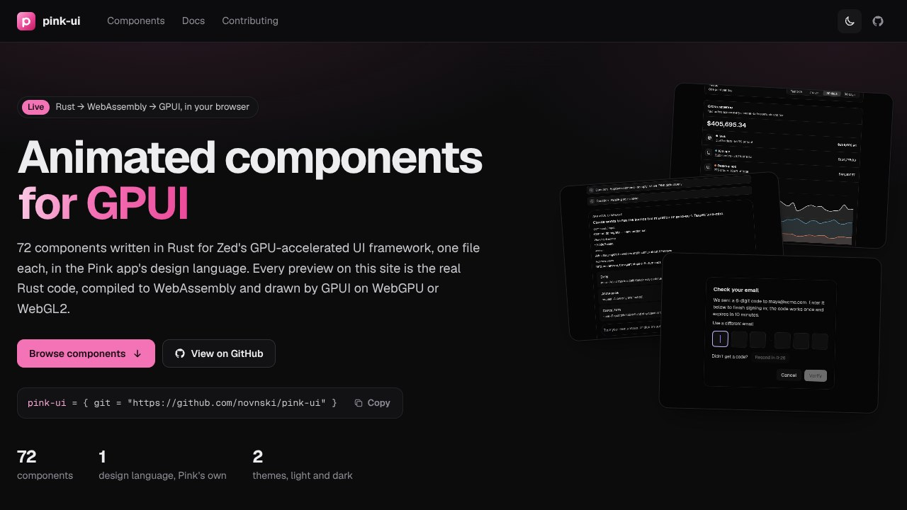

<p align="center">
  <a href="https://novnski.github.io/pink-ui/"></a>
</p>

<p align="center">
  <a href="https://novnski.github.io/pink-ui/"></a>
  <a href="https://github.com/novnski/pink-ui/actions/workflows/ci.yml"></a>
  <a href="https://crates.io/crates/gpui-pre"></a>
  
  <br>
  <a href="#components"></a>
  <a href="https://gpui.rs"></a>
  <a href="LICENSE"></a>
</p>

<p align="center">
  <b>Animated components for GPUI, written in Rust.</b><br>
  73 components for Zed's GPU-accelerated UI framework, one file each, in the
  Pink app's design language. Build one, drop it into <code>.child(…)</code>, and
  it animates – on the desktop, and live in your browser through WebAssembly.
</p>

<p align="center">
  <a href="https://novnski.github.io/pink-ui/"><b>Live showcase</b></a> ·
  <a href="#using-it-in-an-app">Quick start</a> ·
  <a href="#components">Components</a> ·
  <a href="#in-the-browser">How it works</a> ·
  <a href="CONTRIBUTING.md">Contributing</a>
</p>

---



- **73 components** in the Pink app's design language: its runtime palette
  (Geist, neutral surfaces, the violet accent), its radius, spacing and type
  ladders, its controls, motion and loaders, in light and dark.
- **The app's components come from here.** Where PINK ships a component –
  the sidebar rows, the composer's chips and discs, its menus, settings
  sections, the tool group – it draws it from a package under
  [`components/`](components), pinned by revision. Changes land here first and
  the app follows.
- A guide to the design language for new components:
  [`docs/pink-design.md`](docs/pink-design.md).

Each component is one Rust file in [`src/components/`](src/components), and its
API is a builder: build it, drop it into `.child(…)`. State lives in the
component (keyed by its id), and callbacks report what the user did.

```rust
use pink_ui::components::profile_menu::{ProfileMenu, ProfileSetup};

div().child(
    ProfileMenu::new("account", "Lena Hartmann", "lena@fastmail.com")
        .setup(ProfileSetup::new(3, 5).next("Add a profile photo")),
)
```

## Components


| Category | Component | What it is |
| -------- | --------- | ---------- |
| Chat | [AI Answer](https://novnski.github.io/pink-ui/#ai-answer) | One assistant turn as Pink's transcript draws it – the question in a bubble, the searches and pages behind the reply folded into a tool group, an answer that fades in as it streams with citations that preview their source, and Retry and Copy on hover once it settles |
| Chat | [Chat Composer](https://novnski.github.io/pink-ui/#chat-composer) | The composer's prompt pill – square attachment thumbnails over a field that grows as you type, quiet model, access and web search chips whose menus open upward, voice input, a project chip above, and a Send disc that turns into Queue or Stop while a turn runs |
| Chat | [Thinking State](https://novnski.github.io/pink-ui/#thinking-state) | An assistant's reasoning as it works – thoughts and the tool calls between them arriving one by one on a drawn rail under a summary that shimmers while live, a streaming thought open to its text, the current step and a timer on the working line, folding to one quiet line when the work is done |
| Chat | [Writing Assistant](https://novnski.github.io/pink-ui/#writing-assistant) | Rewrite a selection in place – pick a direction, type or dictate what to change, watch the new version fade in under a live working line, page through versions and replace the selection |
| Chat | [Thinking Loader](https://novnski.github.io/pink-ui/#thinking-loader) | The live line under an AI reply while it works – a breathing orb, a shimmering status that names what it is doing, a ticking timer and a quiet Stop on hover |
| Chat | [Cited Answer](https://novnski.github.io/pink-ui/#cited-answer) | An answer beside the sources it rests on – superscript citations that wash their sentence and light their source when pointed at, and source cards that fold open on the quoted passage with the backing words marked, ready to copy or open |
| Chat | [Comment Thread](https://novnski.github.io/pink-ui/#comment-thread) | An inline review thread pinned to a line – replies with their authors, an assistant whose summary folds open onto the activity rail, a shimmering working line while it answers @mentions, and Pink's draft card to reply |
| Chat | [Comments Panel](https://novnski.github.io/pink-ui/#comments-panel) | A document's review comments in a side pane – flat note cards pinned to a line, slash-command notes that run as an edit and show the change as a diff with an Undo, resolving that folds a note away into Resolved, and a draft card where / opens command completion |
| Chat | [Message Actions](https://novnski.github.io/pink-ui/#message-actions) | The hover lane under a chat message – its timestamp and quiet icon actions to branch into a side chat, fork from here, edit, rewind or copy, fading in while the message is hovered, with Copy turning into a check |
| Chat | [Model Picker](https://novnski.github.io/pink-ui/#model-picker) | A composer's model chip and menu – provider tabs, a search row, compact model rows with ⌘ shortcuts and stars, and a tray whose Reasoning and option rows open nested choices |
| Chat | [Markdown Message](https://novnski.github.io/pink-ui/#markdown-message) | An AI reply rendered from markdown the way Pink's transcript draws it – headings, accent list markers and task checkboxes, quotes, frameless tables and code fences with syntax colors, Fit and Copy, with streamed text dissolving in as it arrives |
| Agents | [Agent Cursors](https://novnski.github.io/pink-ui/#agent-cursors) | Agents edit a shared document like teammates – tinted pointers glide to their spot, type suggestions letter by letter, resize a figure and fix a config, and every change waits in a margin note to accept or dismiss |
| Agents | [Agent Inbox](https://novnski.github.io/pink-ui/#agent-inbox) | Every agent task in one triage list – what needs you, fresh results and live work in three quiet sections, each row gliding to its new place as its task changes |
| Agents | [Agent Lanes](https://novnski.github.io/pink-ui/#agent-lanes) | Every agent's work as a board column of time – cards grow down into a now line, hand-offs step across lanes on a hairline rail, a 5, 15 or 30 minute switch rescales it all, and an approval waits on its card with Approve and Deny |
| Agents | [Agent Plan](https://novnski.github.io/pink-ui/#agent-plan) | An agent's plan stacked on the composer – reorder, rename, drop or add steps in a tray tucked behind the pill, then follow the run as a quiet 2/5 · In progress line that unfolds into one status per step, with a notice to retry or skip a step that fails |
| Agents | [Agent Steering](https://novnski.github.io/pink-ui/#agent-steering) | A running agent's chat pane – notes typed while it works wait in a queue tray behind the composer, where you reorder or edit them, steer one into the running step or send it now to interrupt, under the goal bar, checklist and live activity of the run |
| Agents | [Agent Tree](https://novnski.github.io/pink-ui/#agent-tree) | A multi-agent run as a nested agents list – status, model, spend and runtime on every row, sub-agents on a rail that folds away, and an inspector with the selected agent's usage and Stop / Retry |
| Agents | [Approval Card](https://novnski.github.io/pink-ui/#approval-card) | An agent's request to act, asked in the composer's place – the action and its context, numbered choices you can pick with 1–9, a countdown PINK answers for you unless you keep waiting, and a quiet one-line record in the transcript once it is answered |
| Agents | [Autonomy Dial](https://novnski.github.io/pink-ui/#autonomy-dial) | An agent's access card – a quiet level chip opens the Permission mode menu (Limited access, Approve for me, Full access) and the agent's actions glide between Unattended and Needs approval, with a lock for any action that must always ask |
| Agents | [Context Window](https://novnski.github.io/pink-ui/#context-window) | A composer's context chip – a ring and the share in use, muted, then warning and danger as it fills, with the token count on hover – that opens a card mapping the window one cell per percent, with a breakdown that lights its cells, files to drop, and Compact and Clear context |
| Agents | [Delegate Board](https://novnski.github.io/pink-ui/#delegate-board) | Hand work to agents by dragging tasks from the Backlog onto their columns – each column previews the agent's new free-at time before you let go, and Auto-assign gives new work to whoever frees up first |
| Agents | [Inline Diff](https://novnski.github.io/pink-ui/#inline-diff) | An agent's edits to a file as Pink's inline diff – old and new lines on red and green washes with the changed words marked, a review card under the edit in focus to keep or drop it with Y / N, and a footer that settles the rest and applies the review |
| Agents | [Memory Panel](https://novnski.github.io/pink-ui/#memory-panel) | What the assistant remembers about you on a Pink settings card – filter by category, pin, edit in place or forget a memory with an Undo countdown, add your own, or pause memory with its switch |
| Agents | [Permission Request](https://novnski.github.io/pink-ui/#permission-request) | An agent stops to ask before it acts – the composer becomes the request, with the exact command, where and why, numbered choices that each name their grant scope, room to type your own answer, and a quiet Question record once you answer |
| Agents | [Tool Call Card](https://novnski.github.io/pink-ui/#tool-call-card) | An agent's tool calls folded into one quiet line that shimmers while the run is live – open it for one row per call on an activity rail, a spinner while it runs or a red Failed when it didn't, and each row folds open to its command and output with copy |
| Agents | [Recovery Card](https://novnski.github.io/pink-ui/#recovery-card) | The transcript notice for a turn that failed and is recovering: one card per failure that names its cause, a plain headline such as Retrying in 5s, attempt 2 of 3, and Send now, Open Providers or Cancel on its title row |
| Agents | [Trace Waterfall](https://novnski.github.io/pink-ui/#trace-waterfall) | An agent run against time – its sub-agents, model calls and tool calls on an activity rail that folds, each with a duration bar and its time and cost on a shared axis, a live working line while it runs and a readout of the step under the pointer |
| Agents | [Automation Editor](https://novnski.github.io/pink-ui/#automation-editor) | The form behind a scheduled prompt on a Pink settings card – a name and message, a schedule picked from five kinds with weekday chips and the cadence spelled out beside a clock, where each run goes, the model, folded extra options, and a host review that has to pass before Save |
| Agents | [Subagent Cards](https://novnski.github.io/pink-ui/#subagent-cards) | The cards a chat's helper agents leave in its transcript – each names its model, wears a status dot with a ticking or settled timer and a one-line preview of the ask or the latest reply, and opens the helper's chat on its own or in a split, with its result posted below as a linked notice |
| Code | [Diff Viewer](https://novnski.github.io/pink-ui/#diff-viewer) | A checkout's changes as Pink's diff pane – one folding section per file with its icon, path and +N −N, hunk bands over unified or side-by-side rows with the changed words washed, a sticky file header, scope and base pickers, and a + on any line to leave a review comment |
| Code | [Commit History](https://novnski.github.io/pink-ui/#commit-history) | A repository's commits as Pink's History pane – a lane graph that traces every branch and merge, branch, remote and tag pills, author, date and SHA columns you can resize and reorder, and a toolbar to search, fetch and fold the list down to branch tips |
| Code | [Git Actions](https://novnski.github.io/pink-ui/#git-actions) | The Git card from Pink's changes pane – branch and remote, the one next step it recommends with that button lit, the pull request's state, checks and draft form, file checkpoints, staged files to pick for a commit, and Commit and Push that say when they run, land or fail |
| Code | [Terminal](https://novnski.github.io/pink-ui/#terminal) | A terminal drawer as Pink draws it – session tabs you can reorder, a monospace grid in Pink's sixteen ANSI colors with a translucent block cursor, drag, word and line selection, scrollback behind a quiet rail, and a Commands shelf for the project's saved tasks |
| Cards | [Email Draft](https://novnski.github.io/pink-ui/#email-draft) | An agent-written email waiting for review – switch the recipient from a menu, pick a tone, edit the text in place or drop the attachment, then send or discard it into a one-line receipt with undo |
| Cards | [Project Card](https://novnski.github.io/pink-ui/#project-card) | A project as a quiet ticket card – its status and due date beside a ring with one segment per subtask, linked by hover to its people and subtasks, that folds open into a status picker, a people filter and a checklist |
| Cards | [Smart Recommendation](https://novnski.github.io/pink-ui/#smart-recommendation) | A suggested next step with its reason and a confidence signal – alternatives to switch to, the accent on the button that accepts it, and undo |
| Cards | [Tips Panel](https://novnski.github.io/pink-ui/#tips-panel) | Tips laid out like Pink's Board empty state – a heading with a done count over a wrapping grid of quiet tiles, each one action with its verb in the corner, and a taken tip settling into a green check and its done label |
| Data display | [Breakdown Chart](https://novnski.github.io/pink-ui/#breakdown-chart) | A measure split two ways on Pink's usage page – Show, Group by and Split by rows on segmented tracks, the total with its parts' series dots, stacked columns in the usage chart's frame with hover readouts, and a Breakdown table whose columns and rows glide into order |
| Data display | [Change Summary](https://novnski.github.io/pink-ui/#change-summary) | What moved since last time on a Pink section card – one metric per row, its name over what happened, beside a tinted tile whose arrow says which way and whose color says good or bad |
| Data display | [Compact Breakdown](https://novnski.github.io/pink-ui/#compact-breakdown) | A total and its parts laid out like Pink's usage summary – the total in display type over a split bar, one row per part with its series dot, share and change, and a period switch that glides the rows into their new order |
| Data display | [Data Table](https://novnski.github.io/pink-ui/#data-table) | A spreadsheet in one of Pink's card tables – caption headers over hairline rows, ranges under a gliding focus ring, typed in-place edits, tab-separated copy and paste, undo, and columns you sort and resize |
| Data display | [Experiment Card](https://novnski.github.io/pink-ui/#experiment-card) | An A/B test whose header folds open onto each variant's cumulative lift, value and confidence interval – switch the metric, point at a day for a readout, pick a winner and ship it |
| Data display | [KPI Chart](https://novnski.github.io/pink-ui/#kpi-chart) | A period's headline total split into one row per series, over smoothed trend lines – point at a period for a guide, a readout and every series' value |
| Data display | [Usage Meter](https://novnski.github.io/pink-ui/#usage-meter) | A plan's usage card – the share left over a capsule meter that turns amber, then red, the reset and even-pace reading, a strip that speaks up when the cycle runs ahead of its allowance, spend by category over a daily chart and the plan's other limits as compact meters |
| Data display | [Image Lightbox](https://novnski.github.io/pink-ui/#image-lightbox) | A full-size image over a dim scrim – it rises in fitted to the window, zooms about the pointer with ⌃-scroll or a pinch, pans with a drag, names its file underneath and closes with Escape, a click or its glass close capsule |
| Navigation | [Command Menu](https://novnski.github.io/pink-ui/#command-menu) | A ⌘K palette for running anything – one search field over app actions and grouped commands, typed words lit as you type, shortcuts on every row and a footer of key hints |
| Navigation | [Integration Picker](https://novnski.github.io/pink-ui/#integration-picker) | A settings page of apps to connect – Connected and Available cards of rows with a status badge and small actions, a search in the title bar, and a review dialog that gives each permission its own switch, required ones locked on |
| Navigation | [Profile Menu](https://novnski.github.io/pink-ui/#profile-menu) | The account menu above your name – who is signed in, the account actions on one highlight the pointer and arrow keys share, a New badge, Sign out set apart, and the profile setup count over a quiet meter with its next step |
| Navigation | [Segmented Control](https://novnski.github.io/pink-ui/#segmented-control) | Switch between two to five options – a thumb that slides along a quiet track, accent chips or tabs on a hairline – with glyphs, counts, badges and arrow keys |
| Navigation | [Sidebar](https://novnski.github.io/pink-ui/#sidebar) | The app's task sidebar – a project pill with live counts that opens a searchable picker, New thread and page rows, every task with its live status, time and hover actions in folding groups, and quiet Settled and Archived shelves underneath |
| Navigation | [Tab Bar](https://novnski.github.io/pink-ui/#tab-bar) | A workspace's tab row – one strip of chat tabs per split group with live status glyphs, the focused group's tab in a quiet accent tint, tabs that drag to reorder as their neighbours slide aside, and a menu to close, split or reopen them |
| Navigation | [File Tree](https://novnski.github.io/pink-ui/#file-tree) | A project's folders and files in a quiet sidebar tree – folders that fold, keyboard walking, file-type artwork, and a search field that finds files by name or lines inside them |
| Buttons | [Button](https://novnski.github.io/pink-ui/#button) | Primary, secondary, ghost and danger push buttons in three sizes, with glyphs, icon-only squares and a busy spinner |
| Buttons | [Reaction Bar](https://novnski.github.io/pink-ui/#reaction-bar) | Like, comment, repost and share as quiet icon actions under a post – each count in tabular figures beside its glyph, a taken action swapping to its filled glyph as the new count settles in |
| Inputs | [Billing Schedule](https://novnski.github.io/pink-ui/#billing-schedule) | Build a billing plan from a start month, a term, line items on their own cadence, a discount and a monthly minimum, and read its invoices as a total, a grid of figures and a per-invoice cost chart |
| Inputs | [Combobox](https://novnski.github.io/pink-ui/#combobox) | Pick one or many from a searchable picker card – grouped rows with monogram tiles, typed words lit, a check on every pick, picks as badges in the field and an invite row for what isn't listed |
| Inputs | [Date Range Picker](https://novnski.github.io/pink-ui/#date-range-picker) | Pick a reporting window from a pop-up button – period presets on a segmented track, two months whose range band follows the pointer, an optional comparison period and Cancel / Apply, by pointer or keyboard |
| Inputs | [Dropzone](https://novnski.github.io/pink-ui/#dropzone) | An attachments card that takes files dropped from the desktop – a Drop to attach veil while they hover, thumbnails that pulse while read, upload under a radial ring and offer Retry when a transfer stops, an Add files button, and a red strip naming any file over the size limit |
| Inputs | [Filter Menu](https://novnski.github.io/pink-ui/#filter-menu) | A Filters pop-up button with an active count that drops a menu of headed filter groups, Any rows, trailing checks and Clear all filters, driven by pointer or keyboard |
| Inputs | [Integration Settings](https://novnski.github.io/pink-ui/#integration-settings) | A connected service on a Pink settings card – a switch that folds the card to its header when off, a token to show, copy and rotate, an address checked as you type, a sync cadence on a segmented track, a time-zone pop-up menu, and a footer that holds edits until you save |
| Inputs | [OTP Input](https://novnski.github.io/pink-ui/#otp-input) | A one-time code typed one character per cell – dialog-field plates under a gliding focus ring, paste that fills every cell, a plain red line when the code is refused and a resend countdown |
| Inputs | [Prompt Library](https://novnski.github.io/pink-ui/#prompt-library) | Saved prompts in a menu above the composer – open one, type into the blanks of its sentence and use it once nothing is missing |
| Inputs | [Stepper Form](https://novnski.github.io/pink-ui/#stepper-form) | A multi-step setup flow on one paged card – a step counter, captioned fields, numbered choices that move on by themselves, invites you can take back, a review with edit links and a Back / Next footer that says what's missing |
| Inputs | [Find Bar](https://novnski.github.io/pink-ui/#find-bar) | A floating find bar over a conversation – type to wash every match in the transcript, step through them with Enter, Shift+Enter or the arrows, match case with Aa, and read where you are as "3 of 7" |
| Inputs | [Settings Page](https://novnski.github.io/pink-ui/#settings-page) | Pink's settings window – sections in a sidebar with a search that jumps to any setting and marks it, and pages of titled cards whose rows hold switches, segmented tracks and pop-up menus, each with a reset back to its default |
| Inputs | [Appearance Picker](https://novnski.github.io/pink-ui/#appearance-picker) | Pink's Appearance settings – System, Light and Dark as miniature windows of the themes you pick, a menu each for the light and dark theme, accent swatches that re-tint the page, frosted or opaque glass, the interface font and size, and a conversation width slider |
| Feedback | [Decision Inbox](https://novnski.github.io/pink-ui/#decision-inbox) | Decisions waiting on you under a Needs you heading – the current one opens in the question panel with two numbered answers, the rest wait as one-line cards, and answered ones settle into a record you can click to change |
| Feedback | [Notification Stack](https://novnski.github.io/pink-ui/#notification-stack) | Notices piled up above the composer – plates tinted by their tone with a glyph, a label, a capsule action and the message, the ones behind peeking out below the front card until you dismiss it |
| Feedback | [Progress Tracker](https://novnski.github.io/pink-ui/#progress-tracker) | Onboarding checklist card – a done/total summary over a quiet meter, and square checkboxes that tick steps off, one after another in auto play |
| Feedback | [Setup Guide](https://novnski.github.io/pink-ui/#setup-guide) | An onboarding checklist on a quiet card – a progress ring and a 4/10 · Next line that fold the guide away, task groups that open one at a time, the selected task's hint and call to action, tasks that strike through as they're checked off, and a small button that brings a dismissed guide back |
| Feedback | [Toaster](https://novnski.github.io/pink-ui/#toaster) | One quiet capsule of feedback above the composer – a status or error glyph and a single line that fade and rise into place, an optional action, and a notice that clears itself after a few seconds or on dismiss |
| Feedback | [Welcome Screen](https://novnski.github.io/pink-ui/#welcome-screen) | The first thing a new workspace shows – Pink's app icon drawn live, a tile of pink cells that pop in from the centre and ripple under the pointer, above one question, a line on what to do, the one button that starts a project and its shortcut |
| Feedback | [Loaders](https://novnski.github.io/pink-ui/#loaders) | Every Pink loader on one settings card – the breathing orb, the shimmering working line, glyph and mono spinners, the gradient matrix, skeletons, the upload ring, the boot splash and the Pink mark – each shown where the app shows it, with its timing a click away |

## Running the gallery

```sh
cargo run                                    # every component
cargo run -- reaction-bar --theme dark       # open one component
cargo run -- --list
```

The header switches light/dark; Ctrl+↑/↓ steps through the components and Ctrl+R replays the current demo.
Dark mode:



## Using it in an app

```toml
[dependencies]
pink-ui = { git = "https://github.com/novnski/pink-ui" }
gpui = { package = "gpui-pre", version = "=0.3.9" }
gpui_platform = { package = "gpui-pre-platform", version = "=0.3.9", features = ["x11", "wayland"] }
```

```rust
use gpui::{App, Context, Window, WindowOptions, div, prelude::*};

struct Root;

impl Render for Root {
    fn render(&mut self, window: &mut Window, cx: &mut Context<Self>) -> impl IntoElement {
        pink_ui::motion::frame(window, cx); // advances hover fades and glides
        div()
            .size_full()
            .child(/* components */)
            .child(pink_ui::motion::driver()) // keeps frames coming while they move
    }
}

fn main() {
    gpui_platform::application().with_assets(pink_ui::Assets).run(|cx: &mut App| {
        pink_ui::init(cx); // theme, bundled fonts, text input keys
        cx.open_window(WindowOptions::default(), |_, cx| cx.new(|_| Root)).unwrap();
    });
}
```

- **Theme**: `Theme::set_mode(ThemeMode::Dark, cx)` switches every component
  between Pink's light and dark tokens.
- **Motion** ([`src/motion.rs`](src/motion.rs)): CSS `cubic-bezier` curves,
  transition specs, entrance helpers and eased hover fades. Hovers ease through
  the [`HoverFill`](src/interaction.rs) trait (`.hover_fill(..)`,
  `.hover_fill_fg(..)`), like CSS transitions.
- **Text input** ([`src/primitives/text_input.rs`](src/primitives/text_input.rs)):
  single- and multi-line fields with IME, selection, clipboard and word movement.
- **Pink kit** ([`src/pink.rs`](src/pink.rs), [`src/pink/`](src/pink)): the
  app's tokens (`Pink::get(cx)`) and color math, radius/spacing/type ladders,
  elevations, controls (`button`, `chip`, `segmented`, `toggle_switch`,
  `checkbox`, `status_pill`…), surfaces (`popover_card`, `menu_row`,
  `section_card`, `tooltip_card`, `dialog_card`…) and loaders
  (`breathing_orb`, `mini_glyph_spinner`, `shimmer_text`…) – what every
  component is built from.
- **Fonts**: Geist and Geist Mono (the components), Inter (gallery and site
  chrome) and JetBrains Mono are bundled and registered by `init`.

### In an app with its own GPUI

The `pink-ui` crate brings its own GPUI (`gpui-pre`). An app that already has
a GPUI, as PINK does, depends on the packages under
[`components/`](components) instead. Each is its own workspace and depends
only on crates.io `gpui = "=0.2.2"`, which the app patches to its runtime, so
one GPUI type graph remains. Pin a merge commit on `main`:

```toml
[dependencies]
pink-menu-card = { git = "https://github.com/novnski/pink-ui", rev = "<merge commit on main>", package = "pink-menu-card" }

[patch.crates-io]
gpui = { path = "path/to/your/gpui" }
```

A package draws; the app passes resolved colours, fonts and text and adds the
ids, accessibility, focus, tooltips and listeners. PINK's workflow for
changing, pinning and rolling back packages is in its
[pink-ui guide](https://github.com/novnski/pink/blob/main/docs/reference/pink-ui.md).

## In the browser

There is no HTML version of the components to keep in sync: the showcase runs
the same Rust code. GPUI's web platform (`gpui_web`, published as
`gpui-pre-web`) draws into a `<canvas>` with WebGPU, falling back to WebGL2, so
the library compiles to `wasm32-unknown-unknown` unchanged.

- [`web/`](web) is a small wasm-bindgen crate that opens one GPUI window on
  the page and exposes `start`, `show`, `set_theme` and `replay` to
  JavaScript, plus `catalog()`, the component list as JSON, which the site's
  build reads from Node.
- [`site/`](site) is the static showcase: plain HTML, CSS and JS. Each
  component page embeds `play.html`, which hosts the wasm module; switching
  components calls `show` instead of reloading it.
- [`scripts/build-site.sh`](scripts/build-site.sh) builds both into
  `site/dist/`, and [`.github/workflows/pages.yml`](.github/workflows/pages.yml)
  deploys that to GitHub Pages on every push to `main`. The catalog's
  thumbnails are committed in `site/thumbs/`; after changing how a component
  looks, rerender them with `node scripts/site/thumbnails.mjs site/dist`
  (needs Playwright), which also fails if any component panics in the
  browser.

```sh
rustup target add wasm32-unknown-unknown
cargo install wasm-bindgen-cli --version 0.2.129   # must match Cargo.lock
scripts/build-site.sh
python3 -m http.server -d site/dist 8000         # http://localhost:8000
```

Browser builds are single-threaded (threads would need nightly Rust and
cross-origin isolation headers, which GitHub Pages can't send), and clocks
come from `web_time`, since `std::time::Instant` panics on wasm32. Clippy
enforces the latter for the wasm target (see `clippy.toml`).

## Development

GPUI on Linux needs the X11/Wayland and Vulkan development packages:

```sh
sudo apt install libxkbcommon-dev libxkbcommon-x11-dev libwayland-dev libvulkan-dev \
  libx11-xcb-dev libxcb1-dev libfontconfig-dev libfreetype-dev
```

The library tracks [`gpui-pre`](https://crates.io/crates/gpui-pre), weekly
snapshots of Zed's GPUI (the crates.io `gpui` release predates the web
platform). Versions are pinned exactly; bump `gpui-pre` and `gpui-pre-platform`
together, in both `Cargo.toml` and `web/Cargo.toml`.

`scripts/screenshot.sh <slug> [light|dark] [out.png] [WxH]`
renders a component headlessly (Xvfb, openbox, xdotool, ImageMagick). See
[CONTRIBUTING.md](CONTRIBUTING.md) for how a component is built.

## License

[MIT](LICENSE). See [THIRD_PARTY_NOTICES.md](THIRD_PARTY_NOTICES.md) for GPUI,
the Pink app's UI crate and icon sets, the bundled fonts and the MIT-licensed
work some components were first ported from.
