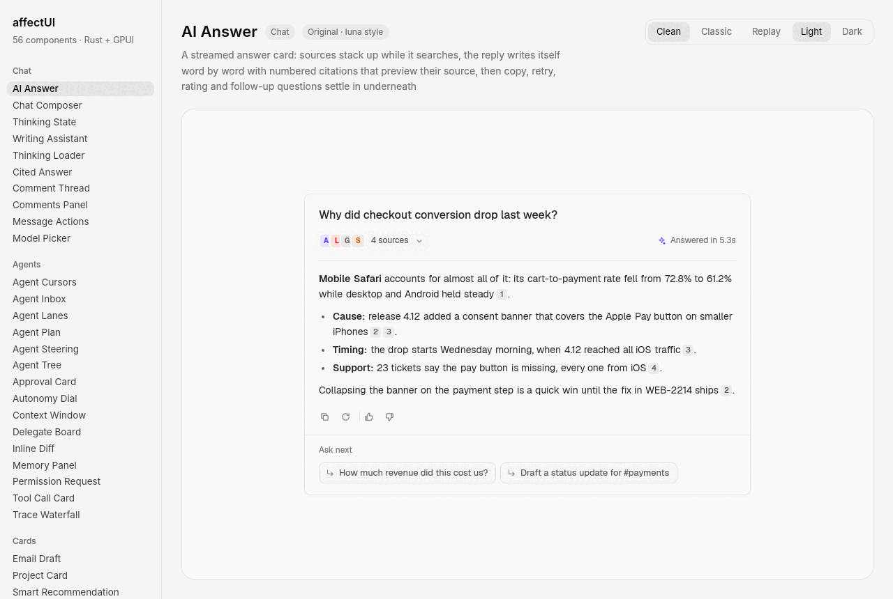
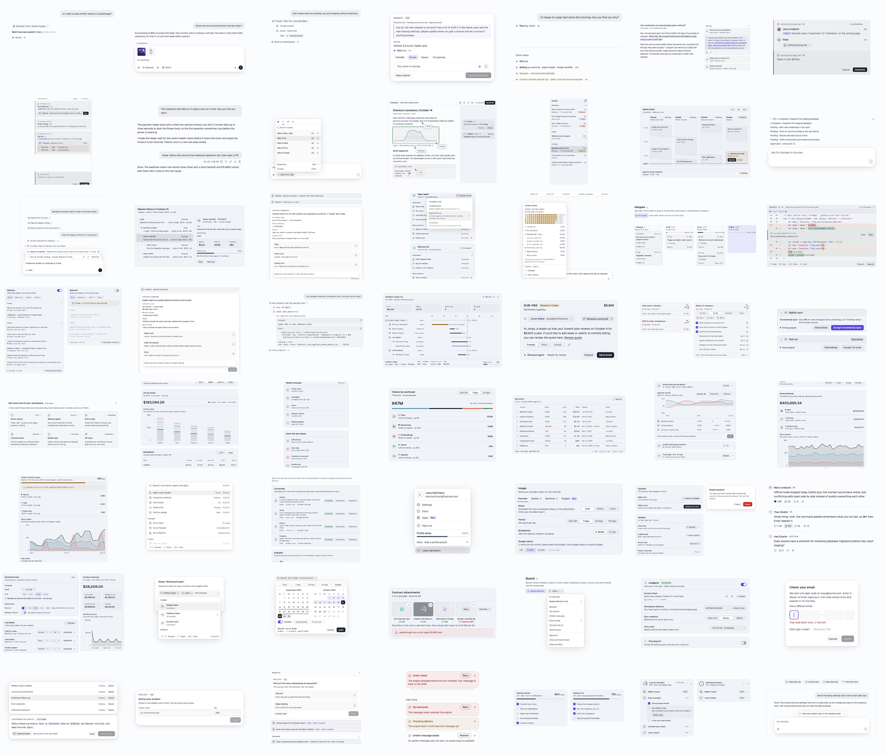
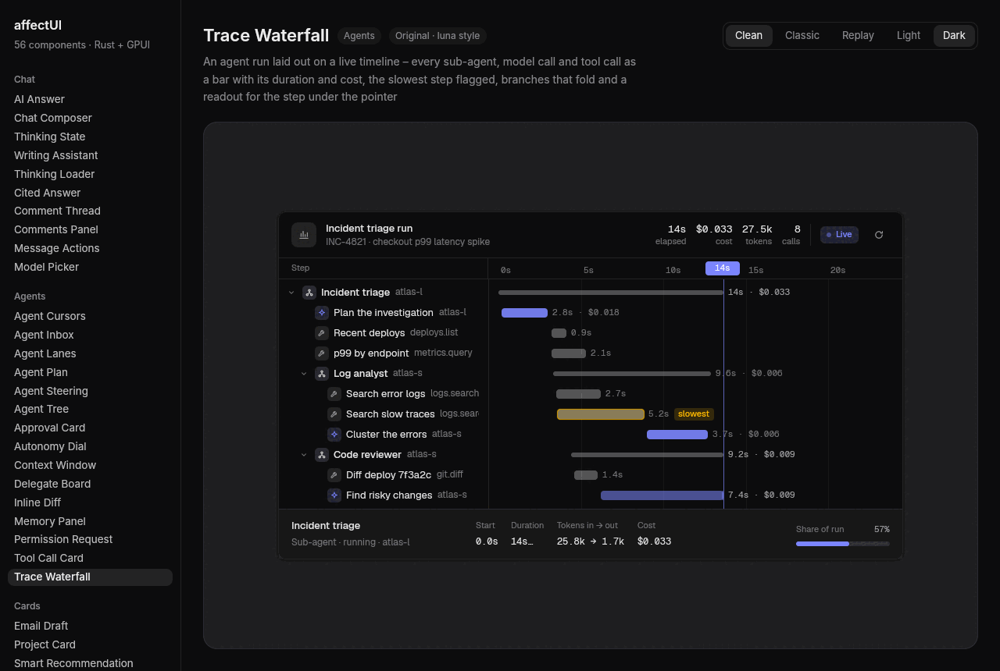

# pink-ui

Animated components for [GPUI](https://gpui.rs), Zed's GPU-accelerated Rust UI
framework – 56 of them, each one file, running natively on the desktop and
live in the browser.

**[Open the showcase →](https://novnski.github.io/pink-ui/)** every component, running for real in your
browser (WebGPU, or WebGL2 where that's missing).



- **17 core components** in two looks, **Clean** and **Classic**, light and dark.
- **39 luna components** in luna's design language (Geist, neutral surfaces,
  indigo accent, its radius and spacing ladders), light and dark.

Each component is one Rust file in [`src/components/`](src/components), and its
API is a builder: build it, drop it into `.child(…)`. State lives in the
component (keyed by its id), and callbacks report what the user did.

```rust
use pink_ui::components::profile_menu::{ProfileMenu, ProfileSetup};

div().child(
    ProfileMenu::new("account", "Lena Hartmann", "lena@fastmail.com")
        .setup(ProfileSetup::new(3, 5).next("Add a profile photo")),
)
```

## Components



### Core components

In both looks (Clean and Classic) and both themes.

| Category | Component | What it is |
| -------- | --------- | ---------- |
| Chat | [Thinking Loader](https://novnski.github.io/pink-ui/#thinking-loader) | A small working pill for AI replies – an eight-ray spinner and a shimmering label that rolls through phases and settles on a check |
| Chat | [Comment Thread](https://novnski.github.io/pink-ui/#comment-thread) | One comment with replies – an assistant reports what it did, folds open details and answers @mentions |
| Chat | [Message Actions](https://novnski.github.io/pink-ui/#message-actions) | The quiet bar under an AI message – copy turns into a check, regenerate spins and unfolds a version switcher, thumbs pop and ask why, read aloud becomes a tiny equalizer |
| Agents | [Tool Call Card](https://novnski.github.io/pink-ui/#tool-call-card) | An agent's tool call in one line – live timer, status and summary, folds open to highlighted arguments and result with copy, retry on errors and a group that sums them up |
| Cards | [Email Draft](https://novnski.github.io/pink-ui/#email-draft) | Agent-written email for review – switch recipient and tone, edit inline, remove the attachment, send or discard with undo |
| Cards | [Smart Recommendation](https://novnski.github.io/pink-ui/#smart-recommendation) | Suggestion card with a confidence signal, alternatives to switch to and accept with undo |
| Cards | [Tips Panel](https://novnski.github.io/pink-ui/#tips-panel) | Grid of short tips with one action each – taken tips turn into a done state |
| Data display | [Change Summary](https://novnski.github.io/pink-ui/#change-summary) | What moved since last time – one metric per row with a colored trend |
| Navigation | [Profile Menu](https://novnski.github.io/pink-ui/#profile-menu) | Account card with the signed-in user, menu actions and profile setup progress |
| Navigation | [Segmented Control](https://novnski.github.io/pink-ui/#segmented-control) | Switch between two to six options – a raised pill or underline that glides, stretches a little and can be dragged across, with icons, counts and badges |
| Buttons | [Button](https://novnski.github.io/pink-ui/#button) | Primary, secondary, ghost and destructive buttons with icons, sizes and a shimmering loading state |
| Buttons | [Reaction Bar](https://novnski.github.io/pink-ui/#reaction-bar) | Like, comment, repost and share in one pill – icons pop and fill, counts roll in digit by digit |
| Inputs | [Filter Menu](https://novnski.github.io/pink-ui/#filter-menu) | Grouped filters with removable chips, collapsible checkbox groups, Clear all and full keyboard control |
| Inputs | [OTP Input](https://novnski.github.io/pink-ui/#otp-input) | The verification code field done right – a gliding focus ring, paste and SMS autofill, a calm shake on errors and a morph into Verified |
| Feedback | [Decision Inbox](https://novnski.github.io/pink-ui/#decision-inbox) | Open decisions with two quick answers each – answered ones confirm and fold away |
| Feedback | [Notification Stack](https://novnski.github.io/pink-ui/#notification-stack) | Notice cards stacked behind each other – dismiss the front one to reveal the next |
| Feedback | [Progress Tracker](https://novnski.github.io/pink-ui/#progress-tracker) | Onboarding checklist with an animated progress bar, ticks that draw themselves and auto play |

### Luna components

In luna's design language; they follow light/dark, and the Clean/Classic look
doesn't apply.

| Category | Component | What it is |
| -------- | --------- | ---------- |
| Chat | [AI Answer](https://novnski.github.io/pink-ui/#ai-answer) | A streamed answer card: sources stack up while it searches, the reply writes itself word by word with numbered citations that preview their source, then copy, retry, rating and follow-up questions settle in underneath |
| Chat | [Chat Composer](https://novnski.github.io/pink-ui/#chat-composer) | A prompt box with file cards, rotating example prompts, web search and ask-first toggles, a keyboard-driven model menu, voice input with a live level meter and a project-scoped footer |
| Chat | [Thinking State](https://novnski.github.io/pink-ui/#thinking-state) | A live working panel: a ticking timer and a filling hairline over steps that rise in one by one, the files each step read popping in as chips, folding to a one-line summary when the work is done |
| Chat | [Writing Assistant](https://novnski.github.io/pink-ui/#writing-assistant) | A rewrite companion for selected text: pick a direction, type or dictate an instruction, and watch the new version stream in over a drifting glow, then step through versions and replace the selection |
| Chat | [Cited Answer](https://novnski.github.io/pink-ui/#cited-answer) | An answer wired to its evidence: point at a citation to light its sentence and its source, click it to unfold the quoted passage beside the answer with the supporting words marked |
| Chat | [Comments Panel](https://novnski.github.io/pink-ui/#comments-panel) | A document's comment sidebar: anchored notes, slash-command comments that run as edits with a before/after preview and undo, resolving that folds comments away, and a composer that completes commands |
| Chat | [Model Picker](https://novnski.github.io/pink-ui/#model-picker) | A composer's model menu with a live spec sheet – point at a model to glide its meters and roll its latency and price, then unfold a reasoning budget |
| Agents | [Agent Cursors](https://novnski.github.io/pink-ui/#agent-cursors) | Agents edit a shared document like teammates – named pointers glide to their spot, type suggestions letter by letter, resize a figure, fix a config and leave margin notes to accept or dismiss |
| Agents | [Agent Inbox](https://novnski.github.io/pink-ui/#agent-inbox) | One calm list for every background agent task – urgent work floats up, counts roll as states change, and each row unfolds into its last steps and the right next action |
| Agents | [Agent Lanes](https://novnski.github.io/pink-ui/#agent-lanes) | A live column of time for each agent – work grows down into now, hand-offs link one agent's output to the next, and approvals wait right on the block |
| Agents | [Agent Plan](https://novnski.github.io/pink-ui/#agent-plan) | Shape an agent's plan before it starts – rename, reorder, drop or add steps – then follow the run step by step and pick it up again from a failed step |
| Agents | [Agent Steering](https://novnski.github.io/pink-ui/#agent-steering) | Steer a running agent: queue a note for its next step and watch the plan carry it into the work, or interrupt to apply it at once |
| Agents | [Agent Tree](https://novnski.github.io/pink-ui/#agent-tree) | A multi-agent run as a live outline – status, spend and runtime on every agent, branch costs rolled up, folding branches and an inspector for the selected agent |
| Agents | [Approval Card](https://novnski.github.io/pink-ui/#approval-card) | An agent pauses for sign-off before a risky action – a risk meter, a preview of exactly what will run, shortcuts, a countdown that holds while you read, and a quiet resolved record with undo |
| Agents | [Autonomy Dial](https://novnski.github.io/pink-ui/#autonomy-dial) | A rotary dial for how freely an agent may act – turn it and the agent's actions glide between an unattended lane and a needs-approval lane, with locks for actions that must always wait for you |
| Agents | [Context Window](https://novnski.github.io/pink-ui/#context-window) | A model's context as a field of cells, one per slice of tokens – hover a part to light up its cells, detach files, and summarize the chat history while its cells ripple and clear |
| Agents | [Delegate Board](https://novnski.github.io/pink-ui/#delegate-board) | Assign work by dropping tasks on agent columns – each column previews its new free-at time before you let go, and Auto hands new work to whoever frees up first |
| Agents | [Inline Diff](https://novnski.github.io/pink-ui/#inline-diff) | An agent's edits marked word by word inside the code – step through them and keep or drop each one with a floating rail, Y / N and undo |
| Agents | [Memory Panel](https://novnski.github.io/pink-ui/#memory-panel) | Everything the assistant remembers about you, by category – pin, edit in place or forget each memory with Undo in the tray, add your own, or pause memory with one switch |
| Agents | [Permission Request](https://novnski.github.io/pink-ui/#permission-request) | An agent asks for one exact right and spells out the commands it will run – grant it once, for an hour or for good, and it folds into a live grant line with a countdown and Revoke |
| Agents | [Trace Waterfall](https://novnski.github.io/pink-ui/#trace-waterfall) | An agent run laid out on a live timeline – every sub-agent, model call and tool call as a bar with its duration and cost, the slowest step flagged, branches that fold and a readout for the step under the pointer |
| Cards | [Project Card](https://novnski.github.io/pink-ui/#project-card) | A two-line project summary that unfolds on hover into a status picker, a people filter and its subtasks – all linked to a progress ring with one segment per subtask |
| Data display | [Breakdown Chart](https://novnski.github.io/pink-ui/#breakdown-chart) | Stacked columns you set up in a sentence – measure, slice and split – with a floating breakdown on hover and a linked, sortable table |
| Data display | [Compact Breakdown](https://novnski.github.io/pink-ui/#compact-breakdown) | A total split into ranked parts around a ring; switching the period glides the segments, rolls the numbers and reorders the rows |
| Data display | [Data Table](https://novnski.github.io/pink-ui/#data-table) | A compact spreadsheet: range selection with a gliding cursor, typed in-place editing, tab-separated copy and paste, undo and redo, and sorting that slides the rows |
| Data display | [Experiment Card](https://novnski.github.io/pink-ui/#experiment-card) | An A/B test folded into two lines that unfolds on hover into lift trends and confidence intervals per variant, with a metric switch and a two-step ship |
| Data display | [KPI Chart](https://novnski.github.io/pink-ui/#kpi-chart) | A headline metric over a multi-series trend: a crosshair walks the days, the number rolls with it and a readout splits it by series |
| Data display | [Usage Meter](https://novnski.github.io/pink-ui/#usage-meter) | A billing cycle at a glance: credits by category with a projection to cycle end, a burn-up chart, plan limits and a call to action that speaks up before the allowance runs out |
| Navigation | [Command Menu](https://novnski.github.io/pink-ui/#command-menu) | One field to search and run everything – app actions on numbered tiles, everyday commands in groups, scopes on Tab and matched letters lit as you type |
| Navigation | [Integration Picker](https://novnski.github.io/pink-ui/#integration-picker) | The integrations page of a command menu – search the services, open one to see your workspace and it joined on two tiles, then connect it and choose what it may do |
| Inputs | [Billing Schedule](https://novnski.github.io/pink-ui/#billing-schedule) | Compose a billing plan from line items with their own cadence, a discount and a monthly minimum, and watch the invoice schedule and totals update live |
| Inputs | [Combobox](https://novnski.github.io/pink-ui/#combobox) | Pick one or many from a searchable, grouped list – avatar chips in the field, matched letters lit, Backspace to unpick and new entries created as you type |
| Inputs | [Date Range Picker](https://novnski.github.io/pink-ui/#date-range-picker) | Two months side by side with preset chips, a live preview band while you pick, an optional comparison period and full keyboard control |
| Inputs | [Dropzone](https://novnski.github.io/pink-ui/#dropzone) | A drop target for files from the desktop with per-file type tiles, upload speed and time left, progress rings and retry on failure |
| Inputs | [Integration Settings](https://novnski.github.io/pink-ui/#integration-settings) | Settings card for a connected service: a switch that pauses it, a token you can reveal and rotate, a validated address, sync cadence, time zone and a save bar that rises when something changes |
| Inputs | [Prompt Library](https://novnski.github.io/pink-ui/#prompt-library) | Saved prompt templates you fill in place – type into the blanks of the sentence, watch the prompt assemble below and use it once nothing is missing |
| Inputs | [Stepper Form](https://novnski.github.io/pink-ui/#stepper-form) | A multi-step setup flow with a vertical rail that checks steps off, steps that slide in, a card that resizes to each step, inline validation and a success screen |
| Feedback | [Setup Guide](https://novnski.github.io/pink-ui/#setup-guide) | Onboarding checklist with a progress ring, accordion task groups and tasks that strike through as they get done |
| Feedback | [Toaster](https://novnski.github.io/pink-ui/#toaster) | A stack of quiet notifications that spreads open on hover, pauses its timers, morphs promise toasts into their result and flicks away with a drag |

## Running the gallery

```sh
cargo run                                    # every component
cargo run -- reaction-bar --theme dark       # open one component
cargo run -- reaction-bar --look classic     # the Classic style
cargo run -- --list
```

The header switches light/dark (and Clean/Classic for core components);
Ctrl+↑/↓ steps through the components and Ctrl+R replays the current demo.
Dark mode:



## Using it in an app

```toml
[dependencies]
pink-ui = { git = "https://github.com/novnski/pink-ui" }
gpui = { package = "gpui-pre", version = "=0.3.9" }
gpui_platform = { package = "gpui-pre-platform", version = "=0.3.9", features = ["x11", "wayland"] }
```

```rust
use gpui::{App, Context, Window, WindowOptions, div, prelude::*};

struct Root;

impl Render for Root {
    fn render(&mut self, window: &mut Window, cx: &mut Context<Self>) -> impl IntoElement {
        pink_ui::motion::frame(window, cx); // advances hover fades and glides
        div()
            .size_full()
            .child(/* components */)
            .child(pink_ui::motion::driver()) // keeps frames coming while they move
    }
}

fn main() {
    gpui_platform::application().with_assets(pink_ui::Assets).run(|cx: &mut App| {
        pink_ui::init(cx); // theme, bundled fonts, text input keys
        cx.open_window(WindowOptions::default(), |_, cx| cx.new(|_| Root)).unwrap();
    });
}
```

- **Theme**: `Theme::set_mode(ThemeMode::Dark, cx)` and
  `Theme::set_look(Look::Classic, cx)` switch every component; `.look(..)` on a
  component overrides it for that instance.
- **Motion** ([`src/motion.rs`](src/motion.rs)): CSS `cubic-bezier` curves,
  transition specs, entrance helpers and eased hover fades. Hovers ease through
  the [`HoverFill`](src/interaction.rs) trait (`.hover_fill(..)`,
  `.hover_fill_fg(..)`), like CSS transitions.
- **Text input** ([`src/primitives/text_input.rs`](src/primitives/text_input.rs)):
  single- and multi-line fields with IME, selection, clipboard and word movement.
- **luna kit** ([`src/luna.rs`](src/luna.rs)): luna's tokens (`Luna::get(cx)`),
  radius/spacing/type ladders, Geist, and controls (`button`, `icon_button`,
  `chip`, `badge`, `kbd`, `card`, `overlay`) – what the luna components are
  built from.
- **Fonts**: Inter (core), Geist and Geist Mono (luna) and JetBrains Mono are
  bundled and registered by `init`.

## In the browser

There is no HTML version of the components to keep in sync: the showcase runs
the same Rust code. GPUI's web platform (`gpui_web`, published as
`gpui-pre-web`) draws into a `<canvas>` with WebGPU, falling back to WebGL2, so
the library compiles to `wasm32-unknown-unknown` unchanged.

- [`web/`](web) is a small wasm-bindgen crate that opens one GPUI window on
  the page and exposes `start`, `show`, `set_theme`, `set_look` and `replay` to
  JavaScript, plus `catalog()`, the component list as JSON, which the site's
  build reads from Node.
- [`site/`](site) is the static showcase: plain HTML, CSS and JS. Each
  component page embeds `play.html`, which hosts the wasm module; switching
  components calls `show` instead of reloading it.
- [`scripts/build-site.sh`](scripts/build-site.sh) builds both into
  `site/dist/`, and [`.github/workflows/pages.yml`](.github/workflows/pages.yml)
  deploys that to GitHub Pages on every push to `main`. The catalog's
  thumbnails are committed in `site/thumbs/`; after changing how a component
  looks, rerender them with `node scripts/site/thumbnails.mjs site/dist`
  (needs Playwright), which also fails if any component panics in the
  browser.

```sh
rustup target add wasm32-unknown-unknown
cargo install wasm-bindgen-cli --version 0.2.129   # must match Cargo.lock
scripts/build-site.sh
python3 -m http.server -d site/dist 8000         # http://localhost:8000
```

Browser builds are single-threaded (threads would need nightly Rust and
cross-origin isolation headers, which GitHub Pages can't send), and clocks
come from `web_time`, since `std::time::Instant` panics on wasm32. Clippy
enforces the latter for the wasm target (see `clippy.toml`).

## Development

GPUI on Linux needs the X11/Wayland and Vulkan development packages:

```sh
sudo apt install libxkbcommon-dev libxkbcommon-x11-dev libwayland-dev libvulkan-dev \
  libx11-xcb-dev libxcb1-dev libfontconfig-dev libfreetype-dev
```

The library tracks [`gpui-pre`](https://crates.io/crates/gpui-pre), weekly
snapshots of Zed's GPUI (the crates.io `gpui` release predates the web
platform). Versions are pinned exactly; bump `gpui-pre` and `gpui-pre-platform`
together, in both `Cargo.toml` and `web/Cargo.toml`.

`scripts/screenshot.sh <slug> [light|dark] [out.png] [WxH] [clean|classic]`
renders a component headlessly (Xvfb, openbox, xdotool, ImageMagick). See
[CONTRIBUTING.md](CONTRIBUTING.md) for how a component is built.

## License

MIT. See [THIRD_PARTY_NOTICES.md](THIRD_PARTY_NOTICES.md) for GPUI, luna-ui,
the bundled fonts and the MIT-licensed work the core components derive from.
